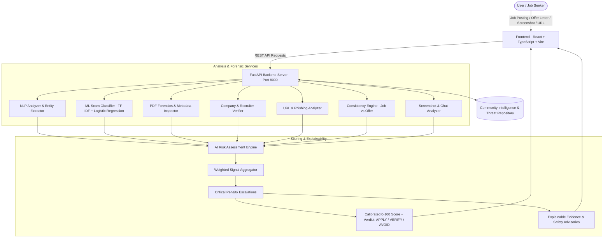

# 🛡️ JobGuard AI

> **Multimodal AI-Powered Employment Fraud Detection, Offer Letter Forensics & Job Scam Prevention Platform**

[](https://www.python.org/)
[](https://fastapi.tiangolo.com/)
[](https://react.dev/)
[](https://www.typescriptlang.org/)
[](https://vite.dev/)
[](https://tailwindcss.com/)
[](LICENSE)

---

## 📌 Table of Contents

- [Overview](#-overview)
- [Key Features](#-key-features)
- [System Architecture](#-system-architecture)
- [Core Engines & Detection Modules](#-core-engines--detection-modules)
- [Directory Structure](#-directory-structure)
- [API Reference](#-api-reference)
- [Quick Start Guide](#-quick-start-guide)
  - [Prerequisites](#prerequisites)
  - [Backend Setup](#1-backend-setup)
  - [Frontend Setup](#2-frontend-setup)
  - [Training the ML Classifier](#3-training-the-ml-classifier)
- [Curated Test Cases](#-curated-test-cases)
- [Official Cybercrime Advisories](#-official-cybercrime-advisories)
- [Contributing](#-contributing)
- [License](#-license)

---

## 📖 Overview

Employment fraud is one of the fastest-growing cybercrimes targeting students, fresh graduates, and remote job seekers. Scammers impersonate top enterprises (such as TCS, Infosys, Microsoft, Google, and major airlines), solicit upfront "training" or "laptop dispatch" fees, run fraudulent Telegram/WhatsApp tasks, and trap victims with fake contracts or identity harvesting.

**JobGuard AI** is an explainable, multi-service security engine designed to detect, analyze, and prevent employment fraud across multiple modalities:
- **Text & Job Descriptions:** NLP entity extraction and TF-IDF machine learning classification.
- **Offer Letters (PDF / Documents):** Metadata forensics, creator tool auditing, font anomaly checks, and clause inspection.
- **Cross-Document Consistency:** Side-by-side reconciliation of initial job postings vs. received offer letters to catch bait-and-switch tactics.
- **Chat & Screenshots:** WhatsApp, Telegram, SMS, and Instagram work-from-home task scam analysis.
- **Recruiter & Domain Verifier:** Corporate email mismatch detection, disposable domain tracking, and suspicious TLD flagging.
- **Community Intelligence:** Crowdsourced scam reporting and verified threat advisories with direct integration into national cybercrime helplines (**1930** / **cybercrime.gov.in**).

---

## ✨ Key Features

| Feature | Description |
|---|---|
| 🔍 **Multimodal Scam Classifier** | Blends heuristic NLP pattern mining with a trained Scikit-learn ML pipeline to calculate risk scores (0–100) and actionable verdicts (**APPLY**, **VERIFY**, or **AVOID**). |
| 📄 **Offer Letter PDF Forensics** | Uncovers document tampering by inspecting creator/producer metadata (e.g., Canva, iLovePDF), font discrepancies, missing corporate tax IDs (GST/CIN), and fraudulent deposit demands. |
| 🔄 **Cross-Document Consistency Engine** | Compares job advertisements against issued offer letters to flag salary drops, designation changes, or unexpected fee introductions. |
| 💬 **Chat Screenshot & Task Scam Guard** | Detects fraudulent "prepaid task" schemes, YouTube rating traps, and crypto deposit rackets across WhatsApp, Telegram, and SMS. |
| 🌐 **Recruiter & Domain Verification** | Flags enterprise impersonation (e.g., recruiters claiming to represent Fortune 500 companies using `@gmail.com` or disposable webmail) and suspicious domain extensions (`.xyz`, `.vip`, `.buzz`, `.top`). |
| 🎓 **Student & Fresher Safety Mode** | Heightens sensitivity toward campus placement fraud, unpaid training deposits, blank cheque requests, and certificate surrender traps. |
| 👥 **Community Scam Intelligence** | Real-time threat repository where users can report fraudulent recruiters, upvote warnings, and stay informed on emerging attack vectors. |
| 🏛️ **Cybercrime Integration** | Direct access to National Cyber Crime Reporting Portal (1930 / I4C) and Sanchar Saathi Chakshu reporting links. |

---

## 🏗️ System Architecture



---

## 🧠 Core Engines & Detection Modules

### 1. Risk Assessment Engine (`risk_engine.py`)
Calibrates evidence signals into a normalized composite score with non-linear penalty escalations:
- **Upfront Payment Penalty:** Any demand for money automatically forces a minimum risk score of **82.0+ (CRITICAL)**.
- **Enterprise Impersonation:** Legitimate enterprise brands using free webmail providers (`@gmail.com`, `@yahoo.com`) trigger a minimum risk score of **85.0+**.
- **Surrender of Documents:** Demands for blank signed cheques or original marksheets trigger instant **AVOID** verdicts.

### 2. PDF & Document Forensics (`pdf_forensics.py`)
- Analyzes PDF dictionary streams and metadata tags (`/Producer`, `/Creator`, `/CreationDate`).
- Flags consumer design apps (Canva, iLovePDF, SmallPDF, Photoshop) used for official enterprise contracts.
- Identifies missing digital signatures, suspicious stamp artifacts, and high-risk monetary clauses.

### 3. Recruiter & Domain Verification (`company_verifier.py` & `url_analyzer.py`)
- Domain mismatch checking against top enterprise domains (`tcs.com`, `infosys.com`, `google.com`, `deloitte.com`, etc.).
- Detection of typo-squatting, fake subdomain prefixes, and suspicious TLDs (`.xyz`, `.vip`, `.buzz`, `.club`, `.top`).
- Detection of temporary/disposable email addresses and unauthorized international numbers.

### 4. Cross-Document Consistency Engine (`consistency_engine.py`)
- Matches original job posting attributes with the resulting offer letter.
- Generates a comparison matrix tracking role title shifts, salary variance, and sudden requirement of registration fees or security deposits.

---

## 📁 Directory Structure

```text
JOBGUARD AI/
├── backend/
│   ├── app/
│   │   ├── data/
│   │   │   ├── community_reports.json   # Crowdsourced scam database
│   │   │   └── sample_cases.json        # Curated fraudulent & authentic presets
│   │   ├── ml/
│   │   │   ├── scam_classifier.pkl      # Trained Scikit-learn model artifact
│   │   │   └── train_model.py           # ML training script (TF-IDF + Logistic Regression)
│   │   ├── models/
│   │   │   └── schemas.py               # Pydantic data schemas & response models
│   │   ├── services/
│   │   │   ├── community_service.py     # Threat intel & report upvoting service
│   │   │   ├── company_verifier.py      # Recruiter email & corporate domain validator
│   │   │   ├── consistency_engine.py    # Cross-document inconsistency matcher
│   │   │   ├── nlp_analyzer.py          # Entity extractor & pattern detection
│   │   │   ├── pdf_forensics.py         # PDF byte & metadata analyzer
│   │   │   ├── risk_engine.py           # Calibrated risk scoring & verdict generator
│   │   │   ├── screenshot_analyzer.py   # Chat & social media fraud detector
│   │   │   └── url_analyzer.py          # URL security & phishing inspector
│   │   └── main.py                      # FastAPI application entrypoint & routing
│   ├── requirements.txt                 # Backend Python dependencies
│   └── run.py                           # Local server launcher (Uvicorn)
├── frontend/
│   ├── public/                          # Static assets and icons
│   ├── src/
│   │   ├── assets/                      # UI images and badges
│   │   ├── App.tsx                      # Main application UI
│   │   ├── App.css                      # Application styling
│   │   ├── index.css                    # Tailwind CSS configuration
│   │   └── main.tsx                     # React application entrypoint
│   ├── package.json                     # Frontend dependencies & scripts
│   ├── tsconfig.json                    # TypeScript compiler configuration
│   └── vite.config.ts                   # Vite build configuration
└── README.md                            # Main project documentation
```

---

## 🔌 API Reference

### Health & Diagnostic
- `GET /api/health` — Check engine status, active modules, and ML pipeline availability.
- `GET /api/stats` — Platform metrics, total scams analyzed, money saved, and threat distribution.
- `GET /api/advisories` — Official Indian Cyber Crime Coordination Centre (I4C) advisories.

### Analysis Endpoints
- `POST /api/analyze/job` — Multimodal job posting verification (text, recruiter, URL, salary).
- `POST /api/analyze/url` — Specialized analysis of job application links and domains.
- `POST /api/analyze/offer-letter` — Forensic analysis of PDF offer letters or raw contract text.
- `POST /api/analyze/consistency` — Cross-checks an initial job advertisement against a received offer letter.
- `POST /api/analyze/screenshot` — Analyzes screenshots or chat transcripts from WhatsApp, Telegram, or SMS.

### Community Threat Intelligence
- `GET /api/community/reports` — Retrieve user-reported scam cases with optional filters.
- `POST /api/community/reports` — Submit a new scam incident to the community repository.
- `POST /api/community/reports/{id}/upvote` — Upvote a report to strengthen verification status.
- `GET /api/samples` — Retrieve curated authentic and fraudulent presets.

---

## 🚀 Quick Start Guide

### Prerequisites
- **Python**: `3.10` or higher
- **Node.js**: `18.0` or higher (with `npm`)
- **Git**

---

### 1. Backend Setup

```bash
# Navigate to the backend directory
cd backend

# Create a virtual environment (Windows PowerShell)
python -m venv venv
.\venv\Scripts\Activate.ps1

# On Linux/macOS:
# source venv/bin/activate

# Install required dependencies
pip install -r requirements.txt

# Start the FastAPI server
python run.py
```

The backend server will run at: **`http://127.0.0.1:8000`**  
Interactive API Docs (Swagger): **`http://127.0.0.1:8000/docs`**

---

### 2. Frontend Setup

```bash
# Open a new terminal and navigate to the frontend directory
cd frontend

# Install dependencies
npm install

# Start the Vite development server
npm run dev
```

The frontend application will run at: **`http://localhost:5173`**

---

### 3. Training the ML Classifier

To retrain or update the scam classification model with new samples:

```bash
cd backend
python -m app.ml.train_model
```
This regenerates `backend/app/ml/scam_classifier.pkl` with the latest feature vectors.

---

## 🧪 Curated Test Cases

JobGuard AI comes pre-loaded with curated sample scenarios accessible via `/api/samples`:

1. **Tata Consultancy Services (Fake Gatepass Fee Scam):**
   - *Attack Vector:* Impersonates TCS, promises direct selection without an interview, demands a ₹6,500 refundable security deposit for biometric badge and laptop dispatch via a `@gmail.com` recruiter account.
   - *Verdict:* `AVOID` (Risk: **94.5 / 100**, Critical Penalty Applied).

2. **WhatsApp / Telegram YouTube Rating Syndicate:**
   - *Attack Vector:* Promises ₹3,000–₹8,000/day for liking videos. Solicits small deposits to unlock higher "VIP tasks" on Telegram.
   - *Verdict:* `AVOID` (Risk: **98.0 / 100**).

3. **Fresher Data Entry Identity Trap:**
   - *Attack Vector:* Demands Aadhaar, PAN card, and 2 blank signed cheques with a ₹50,000 penalty bond clause.
   - *Verdict:* `AVOID` (Risk: **96.0 / 100**).

4. **Genuine Enterprise Software Engineer Posting:**
   - *Sample:* Official Microsoft Corporation backend opening with standard corporate benefits and verified domains.
   - *Verdict:* `APPLY` (Risk: **4.0 / 100**).

---

## 🚨 Official Cybercrime Advisories

If you or someone you know has encountered an employment scam:

- 📞 **National Cybercrime Helpline:** Call **`1930`** (Toll-Free in India)
- 🌐 **National Cybercrime Reporting Portal:** [https://cybercrime.gov.in](https://cybercrime.gov.in)
- 📱 **Sanchar Saathi (Chakshu Portal):** [https://sancharsaathi.gov.in/sfc/](https://sancharsaathi.gov.in/sfc/) to report suspected fraud communications via SMS, WhatsApp, or calls.
- 💡 **Golden Rule:** *No legitimate company will ever demand registration fees, laptop security deposits, or blank cheques as a prerequisite for employment.*

---

## 🤝 Contributing

Contributions to JobGuard AI are welcome!

1. Fork the repository: `https://github.com/Athul3588krishna/JOBGUARD-AI.git`
2. Create a feature branch: `git checkout -b feature/NewFeature`
3. Commit your changes: `git commit -m "Add new scam detection heuristic"`
4. Push to your branch: `git push origin feature/NewFeature`
5. Open a Pull Request.

---

## 📄 License

This project is licensed under the [MIT License](LICENSE).
